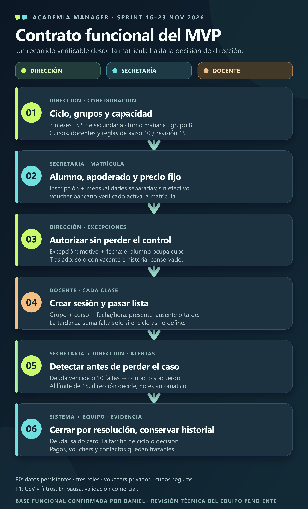

# Guía visual para revisar el contrato funcional

**Reunión:** cierre de `R01` · 16 de noviembre de 2026  
**Presenta:** Daniel Casas  
**Revisan:** Juan Alexis Quispe Luque, Fernando Perez del Castillo y Yony Alex Vilca Mamani  
**Estado:** propuesta funcional confirmada por Daniel; revisión técnica del equipo pendiente.

Esta guía resume el [contrato funcional completo](CONTRATO_FUNCIONAL_MVP.md). La imagen está lista para insertarse en el PDF del informe o en las diapositivas. Se debe presentar como **flujo acordado para construir**, no como software ya implementado ni como validación comercial.

[Abrir la infografía PNG en resolución completa](assets/contrato_mvp_infografia.png) · **2667 × 4400 px** · orientación vertical para página de PDF.

## Reglas que la reunión debe preservar

- **Matrícula:** secretaría registra alumno, apoderado, precio fijo para el ciclo, inscripción y mensualidades. Solo el pago bancario de la inscripción confirmado con voucher activa la matrícula.
- **Excepción:** dirección autoriza motivo y fecha. El alumno ocupa cupo, asiste y, si vence sin pago, sigue asistiendo mientras secretaría contacta a sus apoderados.
- **Traslado:** dirección cambia de turno o grupo solo con cupo disponible, sin borrar pagos ni asistencias anteriores.
- **Pagos:** no hay efectivo. Cada pago, incluido uno parcial, requiere imagen privada del voucher; saldo y anulación mantienen trazabilidad.
- **Asistencia:** docente abre una sesión de grupo, curso, fecha y hora. Dirección configura umbrales del ciclo y si una tardanza suma falta. La demo usa aviso a **10** y revisión a **15** faltas.
- **Decisión:** al alcanzar el límite se alerta a dirección; el sistema no desaprueba automáticamente. Secretaría registra contactos y acuerdos. El caso de deuda termina con saldo cero; el de faltas se cierra al fin del ciclo bajo el límite o tras la decisión de dirección.
- **Accesos:** docente no ve finanzas, vouchers ni datos de apoderados; dirección y secretaría solo ven su academia. La validación comercial está en pausa.

## Matriz de requisito → prueba → evidencia

Esta tabla es una **lista de comprobación futura**. `Pendiente` significa que aún no se ha ejecutado el caso; cada integrante completará la columna de evidencia con una URL, captura o registro real. Los casos `A01`–`A14` se detallan en el [plan final](PLAN_FINAL.md), sección 8.

| ID | Requisito a demostrar | Prueba | Evidencia que se debe adjuntar | Responsable de revisión | Estado |
|---|---|---|---|---|---|
| `RF01` | Ciclo, grupo, cupo, curso y docente persisten. | `A01`, `A14` | Captura antes/después de recargar y registros persistidos. | Juan + Daniel | Pendiente |
| `RF02` | Solo inscripción confirmada o excepción autorizada habilita asistencia; una solicitud pendiente no ocupa cupo. | `A02`, `A03` | Estados de matrícula, cupos y lista del docente. | Fernando + Daniel | Pendiente |
| `RF03` | La excepción conserva motivo/fecha y muestra deuda tras vencer sin impedir asistencia. | `A03` | Vista de dirección, deuda de secretaría y lista del docente. | Fernando + Daniel | Pendiente |
| `RF04` | Traslado con autorización y vacante; rechazo si el destino está lleno; historial intacto. | `A04` | Traslado válido, rechazo y comparación de cupos/historial. | Yony + Daniel | Pendiente |
| `RF05` | Inscripción y mensualidades son cargos separados con precio individual fijo. | `A01`, `A02` | Ficha del alumno y cargos persistidos. | Fernando + Daniel | Pendiente |
| `RF06` | Cada pago bancario exige voucher privado; parcialidad y saldo son correctos; efectivo y sobrepago se rechazan. | `A05`, `A06` | Voucher visible al rol permitido, saldo S/120 tras pagar S/80 de S/200, rechazos sin mutación. | Fernando + Daniel | Pendiente |
| `RF07` | Solo dirección anula un pago con motivo; el saldo se recalcula y queda auditoría. | `A07` | Intentos por ambos roles y registro de anulación. | Fernando + Daniel | Pendiente |
| `RF08` | Docente crea sesión de su grupo/curso, marca asistencia y no duplica ni invade otro grupo. | `A08`, `A10` | Sesión, lista guardada y solicitudes rechazadas. | Yony + Daniel | Pendiente |
| `RF09` | Aviso y límite de faltas siguen la regla del ciclo; tardanza es configurable; no hay desaprobación automática. | `A08`, `A09` | Conteos 10/15, cambio de regla, alerta y decisión registrada. | Fernando + Daniel | Pendiente |
| `RF10` | Contactos y acuerdos persisten; los casos se cierran por resolución, no por simple llamada. | `A13` | Historial de seguimiento, saldo cero y cierre según ciclo/decisión. | Juan + Daniel | Pendiente |
| `RF11` | Docente y academia ajena no acceden a finanzas, apoderados o vouchers por API/Storage. | `A11`, `A12` | Respuestas denegadas y capturas por rol/academia. | Fernando + Daniel | Pendiente |
| `RF12` | El MVP funciona en cloud con HTTPS y datos compartidos entre navegadores. | `A14` | URL pública, despliegue y recorrido desde dos navegadores. | Yony + Daniel | Pendiente |

## Cómo registrar las respuestas

Cada integrante responderá en un comentario del PR o en un acta `.md`: **pregunta → decisión propuesta → archivo/módulo responsable → riesgo o bloqueo → prueba que la comprobará**. Daniel integra las respuestas y anota los cambios aprobados antes de marcar `R01` como completada. No se necesita validar clientes para esta reunión.

## Preguntas finales para el equipo

### Juan — interfaz

1. ¿Qué pantallas mínimas mostrarán dirección, secretaría y docente para completar el recorrido sin cambiar de herramienta ni usar datos fijos?
2. ¿Cómo verá secretaría la diferencia entre solicitud pendiente, matrícula activa y excepción vencida? ¿Cómo mostrará el formulario un voucher faltante, un sobrepago y un grupo lleno?
3. ¿Dónde verá dirección la alerta de 15 faltas y registrará su decisión? ¿La interfaz permite recorrer la demo en 10–15 minutos?

### Fernando — datos y seguridad

1. ¿Qué tablas, restricciones y transacciones impedirán que dos matrículas o traslados simultáneos excedan el cupo?
2. ¿Cómo quedarán vinculados cargo, pago confirmado, referencia y voucher privado para impedir pagos sin imagen, efectivo y sobrepagos, incluso si se llama directamente a la API?
3. ¿Qué políticas de base de datos y Storage impedirán que un docente o la academia B lea datos o vouchers de la academia A?
4. ¿Cómo calculará el conteo de faltas del ciclo, la tardanza configurable y el cierre del caso sin perder el historial?

### Yony — integración y cloud

1. ¿Qué servicios, variables de entorno y pasos de despliegue dejarán la aplicación accesible por HTTPS el día 2 y el recorrido P0 integrado el día 5?
2. ¿Cómo se subirá y consultará un voucher privado desde el navegador sin exponer claves privilegiadas?
3. ¿Cómo se prepararán datos ficticios reproducibles de 9 y 14 faltas para demostrar los umbrales con una sesión nueva?
4. ¿Qué contrato de API o funciones necesita acordar con Juan y Fernando para integrar excepción, traslado, pago y asistencia sin bloquear sus ramas?

### Daniel — cierre de alcance y evidencia

1. ¿Las respuestas de los tres preservan todas las reglas funcionales de esta guía? Si proponen cambiar una, ¿cuál es el motivo y qué prueba cambia?
2. ¿Quién se responsabiliza de cada evidencia `RF01`–`RF12` y dónde se guardará para el informe?
3. ¿Queda algún bloqueo que impida demostrar el recorrido P0 en cloud el 20 de noviembre? ¿Qué ajuste de alcance autorizas sin perder el valor del MVP?
