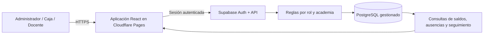

# PLAN FINAL — SaaS de cobranza y asistencia para academias preuniversitarias

> **Archivo canónico de ejecución.** Este documento es la fuente de verdad para integrantes y agentes de IA del proyecto. Si una tarea, captura o texto contradice este archivo, el responsable humano debe resolver la diferencia antes de integrar el cambio. El plan describe trabajo por realizar; no afirma que el software, el informe ni el negocio ya estén validados.

**Periodo:** 16 al 23 de noviembre de 2026, hora de Lima  
**Entrega oficial:** 23 de noviembre, 23:00  
**Meta interna de carga:** 23 de noviembre, antes de las 20:00  
**Equipo:** Juan Alexis Quispe Luque, Fernando Perez del Castillo, Yony Alex Vilca Mamani y Daniel Casas  
**Estado inicial:** no existe código ni hay tecnología obligatoria; se usarán servicios cloud.  
**Documento de referencia:** consigna y rúbrica del curso, conservadas por el equipo en su repositorio de trabajo.

## 0. Cómo debe usar este plan cualquier agente de IA

1. Leer **decisiones cerradas, P0/P1, reglas de datos, tarea asignada y criterio de aceptación** antes de proponer código o texto.
2. Trabajar solo en una tarea identificada en el backlog de la sección 7. El agente puede proponer cambios de alcance, pero Daniel decide prioridades; Fernando aprueba cambios de esquema, permisos y reglas de pago.
3. Entregar siempre: **qué cambió, archivos afectados, cómo se probó, resultado observado, riesgos pendientes y siguiente dependencia**. No presentar una sugerencia como funcionalidad terminada.
4. Usar únicamente datos ficticios de estudiantes; no introducir claves, contraseñas ni identificadores reales en prompts, código, capturas o ZIP.
5. Mantener una distinción estricta entre **evidencia académica** (software que funciona y pruebas) y **evidencia comercial** (entrevistas, piloto, clientes que pagan). Las cifras de demo son ficticias y nunca justifican una afirmación de rentabilidad.
6. Si se detecta un fallo de seguridad, saldo, aislamiento de academias o persistencia, se marca **bloqueante**. Ninguna mejora estética o P1 se integra hasta corregirlo.

**Formato mínimo de reporte de un agente:** `Tarea ID | responsable humano | estado | cambio | prueba ejecutada y resultado | enlace/ruta del artefacto | bloqueo o decisión necesaria`.

## 1. Decisiones cerradas

1. El producto será un SaaS web para academias preuniversitarias pequeñas, inicialmente una sede por academia.
2. El MVP incluirá cuotas y pagos **registrados manualmente**, asistencia, alertas y seguimiento de casos. No procesará dinero ni integrará una pasarela de pago.
3. La demostración utilizará **datos ficticios**. La experiencia previa de integrantes que estudiaron en academias servirá para dibujar el flujo; Daniel buscará entrevistar a **tres responsables actuales de academias** y observar al menos un proceso de cobranza y asistencia durante los días 1–2. La falta de entrevistas no detendrá la entrega académica, pero impedirá afirmar que el negocio está validado.
4. No se estimará el trabajo por horas individuales. Cada día tendrá un resultado verificable, responsables y una decisión de continuar o recortar alcance.
5. Cada integrante participará en el informe y en la exposición; Daniel coordinará la integración documental y el control del proyecto.

## 2. Problema, cliente y promesa de valor

**Cliente que paga:** dueño o administrador de una academia pequeña.  
**Usuarios del sistema:** administrador, caja/secretaría y docente.  
**Problema operativo:** matrícula, cuotas, pagos y asistencia se registran en lugares distintos; por ello se identifican tarde los saldos vencidos y los alumnos que dejan de asistir, y no queda claro quién hizo seguimiento. Esta descripción es una **hipótesis de trabajo** que se contrastará con el flujo de una academia.

**Promesa que la demo debe probar:** un administrador puede detectar hoy qué alumnos requieren contacto, registrar la acción realizada y ver cómo un pago o una nueva asistencia cambia el estado del caso. La aplicación debe hacer esto con registros persistentes y cálculos reales, no con pantallas simuladas. El posicionamiento comercial a probar será **seguimiento conjunto de deuda y ausencias durante ciclos cortos**. Esta combinación tampoco es exclusiva: competidores ya anuncian control de pensiones, faltas y avisos. El equipo deberá demostrar una mejora concreta en el proceso o cambiar su propuesta antes de comercializar.

El éxito comercial todavía no se presume: para estimarlo más adelante habrá que medir disposición a pagar, costo de adquisición y soporte, retención y resultado real en cobranza y asistencia.

## 3. MVP que demuestra valor

### Recorrido obligatorio de punta a punta

1. **Matrícula:** el administrador crea un ciclo, un grupo y un alumno ficticio; lo matricula y asigna cuotas con monto y vencimiento.
2. **Cobranza:** caja registra un pago total o parcial **después de verificarlo por el medio externo utilizado**, con fecha, medio, referencia y responsable de registro. El sistema calcula el saldo a partir de cuotas menos pagos confirmados y no anulados. Un pago erróneo puede ser anulado por el administrador con motivo y rastro; no se borra silenciosamente. El registro interno no sustituye un comprobante tributario.
3. **Asistencia:** el docente crea o abre una sesión de su grupo y marca presente, ausente o tardanza para cada matriculado. Solo puede operar sus grupos.
4. **Detección:** el tablero del administrador muestra monto vencido, cuotas próximas a vencer y alumnos con **dos o más ausencias en sus últimas tres sesiones**.
5. **Acción:** el administrador o caja marca un caso como pendiente, contactado o resuelto, añade fecha y una nota breve. La interfaz conserva el historial. Si desaparece el saldo vencido, el caso de deuda deja de contarse como deuda activa; el historial de contacto permanece.

### Alcance P0: obligatorio para entrega

- Inicio de sesión y autorización efectiva por rol.
- Separación de datos por academia en todas las consultas y escrituras.
- Ciclos, grupos, alumnos y matrículas.
- Cuotas con vencimiento y pagos manuales completos o parciales.
- Sesiones y asistencia.
- Tablero calculado desde la base de datos y lista de casos con estado de seguimiento.
- Despliegue cloud con HTTPS y persistencia tras recargar o entrar desde otro navegador.
- Datos ficticios de demostración, pruebas de permisos y una exportación/respaldado reproducible de esos datos para contingencia.

### Alcance P1: solo si P0 está estable al cierre del día 5

- Exportación CSV de deuda y asistencia para el administrador.
- Filtros adicionales por ciclo o grupo.
- Mejoras visuales y accesibilidad que no alteren el flujo principal.

### Fuera del proyecto de ocho días

Pasarela de pago, emisión tributaria, mensajes automáticos por WhatsApp o SMS, portal de padres, aplicación móvil nativa, importación masiva, predicción de deserción y contabilidad. Ninguna de estas funciones debe desplazar el recorrido P0.

## 4. Roles, datos y reglas

| Rol | Puede hacer | No puede hacer |
|---|---|---|
| Administrador de academia | Configurar ciclos/grupos, matricular, consultar y corregir cuotas y pagos, ver asistencia, administrar usuarios y seguimiento | Acceder a otra academia |
| Caja/secretaría | Registrar alumnos y cuotas, cobrar manualmente, consultar saldos, registrar seguimiento de cobranza | Anular pagos sin autorización; entrar a otra academia |
| Docente | Ver sus grupos, crear sesiones y marcar asistencia | Consultar pagos, saldos o alumnos de otros grupos |

**Entidades mínimas:** academia, usuario/rol, ciclo, grupo, alumno, matrícula, cuota, pago, sesión, asistencia y seguimiento. Todos los registros de operación tendrán `academy_id`; las relaciones y permisos se comprobarán también en la base de datos. El modelo de pago guardará medio, referencia, responsable, estado de anulación y motivo. El sistema impedirá pagos negativos, importes superiores al saldo y una segunda asistencia para el mismo alumno en la misma sesión.

**Contrato mínimo de datos para que los agentes implementen lo mismo:**

| Entidad | Campos esenciales | Regla clave |
|---|---|---|
| `academies` | `id`, `name` | Cada organización tiene un identificador distinto. |
| `memberships` | `academy_id`, `user_id`, `role` | Rol `admin`, `cashier` o `teacher` por academia; las cuentas de demo se crean de forma controlada. No se requiere registro público de usuarios en P0. |
| `cycles`, `groups` | `academy_id`, fechas, nombre; grupo con `cycle_id` y `teacher_user_id` | Un grupo pertenece a un ciclo y tiene un docente responsable en P0. |
| `students`, `enrollments` | `academy_id`, nombre ficticio; matrícula con `student_id`, `cycle_id`, `group_id` | Un alumno puede participar en varios ciclos, pero solo una matrícula por ciclo en P0. |
| `installments` | `academy_id`, `enrollment_id`, `amount`, `due_date` | Importe positivo y vencimiento expresado en fecha local de Lima. |
| `payments` | `academy_id`, `installment_id`, `amount`, `paid_at`, `method`, `reference`, `created_by`, `voided_at`, `void_reason` | Cada pago se aplica a **una cuota**. Caja registra solo pagos verificados externamente; anular requiere rol admin y motivo. |
| `class_sessions`, `attendance` | Sesión con `group_id`, fecha; asistencia con `session_id`, `student_id`, `status` | Estados `present`, `absent`, `late`; una asistencia por alumno y sesión. |
| `followups` | `academy_id`, `student_id`, `cycle_id`, `kind`, `status`, `note`, `contacted_at`, `created_by` | Tipos `debt` y `absence`; la nota no incluirá datos sensibles innecesarios. |

**Cálculos únicos para backend y frontend:** el saldo de una cuota es `amount − suma(payments no anulados)`; una cuota está vencida si `due_date < fecha actual en Lima` y saldo `> 0`. La alerta de asistencia requiere **al menos tres sesiones realizadas** y dos estados `absent` entre las últimas tres; `late` no cuenta como ausencia. La lista de casos se obtiene de estas reglas en la base de datos y se une a `followups`: `pending` o `contacted` es una acción humana; `resolved` se muestra cuando ya no se cumple la condición que originó la alerta. El historial de contacto no se elimina. No se utilizarán tareas programadas para crear casos en P0.

**Autorización:** la interfaz puede ocultar acciones, pero la base de datos debe impedirlas también. Una fila de academia A nunca será visible o modificable por usuarios de B. Un docente solo accederá a grupos asignados y no tendrá permiso de lectura de cuotas, pagos o seguimiento financiero. Los identificadores enviados por el navegador no se considerarán prueba de autorización.

Para un piloto académico se recogerá la información mínima y se usarán datos ficticios. En un uso real con menores, la academia deberá informar adecuadamente sobre el tratamiento de datos y aplicar las reglas de consentimiento correspondientes, además de controles de acceso y retención. Véanse las [orientaciones de la Autoridad Nacional de Protección de Datos Personales](https://www.gob.pe/institucion/minjus/noticias/961170-instituciones-educativas-tienen-la-obligacion-de-informar-adecuadamente-sobre-el-tratamiento-de-datos-personales-de-los-estudiantes) y el [reglamento vigente](https://www.gob.pe/institucion/anpd/campa%C3%B1as/128319-nuevo-reglamento-de-proteccion-de-datos-personales).

## 5. Arquitectura elegida

**Pila propuesta:** React + TypeScript para la aplicación web; Cloudflare Pages para publicar el frontend; Supabase Auth, PostgreSQL y API gestionada para autenticación, datos y lógica transaccional. Se pueden usar funciones SQL o una función de servidor pequeña para registrar pagos y sus anulaciones de forma atómica. Esta elección evita administrar servidores durante los ocho días y deja visibles los conceptos cloud que exige el curso: servicio gestionado, despliegue público, roles, escalabilidad, seguridad y costos. El **tipo de despliegue es público con acceso privado por academia**; el producto vendido al cliente sigue el modelo SaaS, construido sobre servicios PaaS/BaaS gestionados. El informe explicará región elegida, límites del plan, recuperación y ruta de escalado sin atribuir al plan gratuito una disponibilidad garantizada.

Las claves privilegiadas nunca irán en el navegador ni en el ZIP. Las tablas expuestas tendrán políticas de seguridad por fila; se probará la separación con cuentas de dos academias y el bloqueo de finanzas para docentes. [Supabase documenta este control de acceso](https://supabase.com/docs/guides/database/postgres/row-level-security). Se mantendrán migraciones SQL en el repositorio y un archivo `.env.example` sin secretos.

**Límite operativo:** el plan gratuito de Supabase no incluye respaldos automáticos y puede pausar proyectos por inactividad. Sirve para la demostración; una operación comercial requerirá presupuestar plan y respaldo adecuados. [Precios y límites de Supabase](https://supabase.com/pricing).

## 6. Equipo, propiedad del trabajo y agentes de IA

| Integrante | Rol humano y propiedad | Agente de IA asignado y producto esperado | Verificación humana |
|---|---|---|---|
| **Juan Alexis Quispe Luque** | Líder de frontend y experiencia de uso. Responsable de navegación, formularios, tablero e integración visual. | **Agente UI:** propone componentes, validaciones de formulario, estados de carga/error y mejoras de accesibilidad a partir del contrato de datos. | Juan comprueba en navegador cada flujo, incluidos errores y uso móvil. |
| **Fernando Perez del Castillo** | Líder de backend, base de datos y seguridad. Responsable del modelo, reglas de negocio, permisos y cálculos. | **Agente de datos y seguridad:** propone migraciones, consultas, políticas de acceso y pruebas de autorización. | Fernando revisa SQL/código y ejecuta las pruebas de rol y academia. |
| **Yony Alex Vilca Mamani** | Integrador full stack y responsable de cloud. Conecta pantallas y API, configura entornos y despliegues, apoya asistencia y seguimiento. | **Agente de integración:** prepara conectores, scripts de despliegue, datos ficticios y diagnóstico de fallos. | Yony verifica la versión publicada y que los datos persistan. |
| **Daniel Casas** | Gerente de proyecto, documentación y QA; apoyo backend en corrección de defectos. Responsable de alcance, evidencias, informe, paquete y ensayo. | **Agente analista y QA:** convierte la consigna en matriz de requisitos, redacta borradores, genera casos de prueba y comprueba consistencia entre informe y aplicación. | Daniel contrasta fuentes, reproduce pruebas y aprueba el contenido final. |

**Regla de trabajo con IA:** cada tarea entregada a un agente debe indicar entrada, archivo o módulo permitido, criterio de aceptación y prueba esperada. El responsable humano revisa el cambio antes de integrarlo. Los agentes no recibirán datos personales reales, claves de servicio ni capacidad de publicar por su cuenta. Un resultado generado por IA no se declarará probado hasta que una persona lo ejecute.

**Coordinación técnica:** Fernando fija el esquema y las reglas; Juan consume el contrato acordado; Yony resuelve integración y despliegue; Daniel valida el recorrido completo. La rama principal siempre debe permanecer ejecutable. Cada día se hace una reunión breve de bloqueos y una demo de la versión integrada; no se acepta trabajo que solo funcione en el equipo de su autor.

**Ubicación prevista de artefactos en el repositorio del SaaS:** `src/` (interfaz, Juan), `supabase/migrations/` (esquema y políticas, Fernando), `supabase/seed/` (datos ficticios, Yony), `tests/` (pruebas, Daniel y dueños técnicos), `docs/` (diagramas, evidencias, informe y diapositivas, Daniel), `README.md` y `.env.example` (Yony). En el repositorio de este panel, `docs/PLAN_FINAL.md` es la versión compartida del plan; cualquier cambio se hará por PR. Si el equipo elige otra estructura para el SaaS, Yony la documentará en su README antes de repartir tareas. Los agentes no editarán el mismo archivo simultáneamente; cada cambio se revisará e integrará en partes pequeñas.

## 7. Backlog y cronograma de ocho días

### 7.1. Tareas con dueño y aceptación

Los agentes reciben una **ID** y el criterio de aceptación de esta tabla. P0 tiene precedencia sobre cualquier tarea P1. Los dueños pueden pedir ayuda a otro integrante, pero no ceden la aprobación final.

| ID / prioridad | Dueño | Entregable verificable | Depende de | Aceptación mínima |
|---|---|---|---|---|
| `R01` / P0 | Daniel | Flujo, historias, matriz requisito–evidencia y contrato de pantallas/datos | Ninguna | Los cuatro aprueban un mismo recorrido de demo y reglas del MVP el día 1. |
| `C01` / P0 | Yony | Repositorio, configuración, despliegue React y `.env.example` | `R01` | URL HTTPS abre la aplicación; ningún secreto queda en código o ZIP. |
| `B01` / P0 | Fernando | Migraciones, Auth, `memberships`, políticas por rol y academia | `R01` | Tres cuentas de demo entran; docente no lee finanzas y academia B no lee datos de A por API. |
| `B02` / P0 | Fernando | Ciclos, grupos, alumnos, matrícula y cuotas persistentes | `B01` | Un alumno y sus tres cuotas se ven después de recargar o entrar desde otro navegador. |
| `F01` / P0 | Juan | Navegación y formularios de matrícula/cuotas conectados | `C01`, contrato de `B02` | Validación visible y datos reales; estados de carga y error utilizables. |
| `B03` / P0 | Fernando | Registrar pagos parciales y anular con motivo; cálculo transaccional de saldo | `B02` | S/80 aplicado a una cuota de S/200 deja S/120; se rechaza sobrepago y queda auditoría de anulación. |
| `B04` / P0 | Yony | Sesiones y asistencia por docente/grupo | `B01`, `B02` | Solo docente asignado toma lista; se impide duplicar asistencia. |
| `F02` / P0 | Juan | Pantallas de caja y asistencia conectadas | `B03`, `B04` | Se completa pago y pase de lista en versión publicada sin usar datos fijos. |
| `B05` / P0 | Fernando | Consultas de deuda, ausencia y seguimiento | `B03`, `B04` | Regla de dos ausencias en tres sesiones y saldos vencidos calculados en la BD. |
| `F03` / P0 | Juan + Yony | Tablero, lista de casos y estados de contacto | `B05` | Cambian inmediatamente tras registrar pago, ausencia o contacto. |
| `Q01` / P0 | Daniel | Matriz de pruebas y evidencias de ejecución | `B01`–`F03` | Pasan todas las pruebas de salida de la sección 8; defectos bloqueantes resueltos. |
| `D01` / P0 | Daniel | Informe PDF, diapositivas, guion y ZIP reproducible | Evidencia técnica diaria y `Q01` | Cumple la matriz académica de la sección 11 y abre correctamente. |
| `M01` / paralelo | Daniel | Tres entrevistas buscadas, comparación de competidores y estimación ascendente del segmento | `R01` | Fuentes y respuestas registradas; si no hay acceso, se declara sin inventar resultados. |
| `F04` / P1 | Juan | CSV de deuda/asistencia y filtros adicionales | P0 estable al cierre del día 5 | Exportación corresponde a datos visibles y respeta rol/academia. |

### 7.2. Calendario y puertas de salida

| Fecha | Juan — frontend | Fernando — backend/datos | Yony — integración/cloud | Daniel — dirección/QA/informe | Puerta de salida verificable |
|---|---|---|---|---|---|
| **Lun. 16** | Flujo y wireframes de matrícula, caja, docente y tablero. | Esquema, roles, reglas de saldo, ausencia y aislamiento. | Repositorio, entornos, estructura de app y despliegue vacío. | Cierra P0/P1, criterios y matriz requisito–evidencia; agenda entrevistas con responsables actuales y revisa competidores. | Flujo de demo, modelo y contratos aprobados por los cuatro. |
| **Mar. 17** | Navegación, inicio de sesión y formularios base. | Base de datos, Auth, políticas de acceso y migraciones iniciales. | Despliegue accesible, variables de entorno seguras e integración de sesión. | Contrasta flujo en entrevistas/observación; redacta problema, objetivos y método; prepara pruebas por rol. | Tres roles pueden entrar en versión cloud; cada uno ve su menú. |
| **Mié. 18** | Pantallas de ciclos, grupos, alumnos, matrícula y cuotas. | Persistencia y reglas de matrícula/cuotas. | Conecta frontend con API; prueba recarga y segundo navegador. | Prueba casos de matrícula/cuotas; documenta módulos y modelo de datos. | Alumno y cuotas se guardan y reaparecen al entrar de nuevo. |
| **Jue. 19** | Pantallas de pago y asistencia con confirmaciones y errores claros. | Pago total/parcial, saldo, anulación auditada y consulta de deuda. | Implementa sesiones/asistencia y une flujos; corrige integración. | Prueba cálculos, duplicados, permisos; redacta arquitectura, cloud y seguridad. | Pago parcial cambia saldo; docente guarda asistencia real. |
| **Vie. 20** | Tablero y lista de casos con estados de seguimiento. | Consultas de vencidos, ausencias y reglas de casos. | Integra el recorrido completo y publica versión candidata. | Ejecuta demo de punta a punta, registra defectos, valida métricas y propone precio para contrastarlo con entrevistados. | **MVP P0 completo en cloud** antes del cierre del día. |
| **Sáb. 21** | Corrige fallos de uso y formularios; P1 solo si P0 ya pasó. | Corrige seguridad, saldos y consistencia. | Prepara datos ficticios, migraciones y recuperación; revisa despliegue. | Prueba dos academias, tres roles, recarga, casos y rendimiento básico; incorpora capturas/resultados reales y primera estimación ascendente del mercado al informe. | P0 pasa las pruebas; lista de defectos críticos vacía. |
| **Dom. 22** | Ajustes finales de legibilidad y recorrido de demo. | Revisión final de políticas y reglas. | Congela despliegue estable, prepara ZIP reproducible y respaldo de datos ficticios. | **Congela nuevas funciones al mediodía**; cierra informe, referencias, presentación y primer ensayo de 50 minutos. | PDF, ZIP y demo ensayados; solo quedan fallos bloqueantes. |
| **Lun. 23** | Resuelve únicamente fallos que impiden la demo. | Revisa que no haya acceso indebido ni errores de saldo. | Verifica URL, credenciales de demo y paquete; conserva última versión estable. | Ensayo final, revisión de formato y carga de los dos archivos antes de las **20:00**; registra confirmación de entrega. | Entrega confirmada y demo lista, con margen hasta las 23:00. |

**Ruta crítica:** modelo y autorización → matrícula/cuotas → pago y asistencia → cálculos/tablero/seguimiento → integración desplegada → pruebas → demo e informe final. Las tareas documentales empiezan el día 1; no se posponen al final.

## 8. Criterios de aceptación y demostración

Preparar dos academias ficticias, dos ciclos, tres grupos y aproximadamente 30 alumnos inventados. Un caso principal podría tener tres cuotas de S/200: una vencida; al registrar un pago parcial de S/80, el saldo vencido debe bajar de S/200 a S/120. Otro alumno acumulará dos ausencias en sus últimas tres sesiones y aparecerá en la lista de atención. Estas cifras son **datos de prueba**, no resultados comerciales.

La demo de 10–15 minutos seguirá este guion:

1. Entrar como administrador, matricular al alumno y asignar las cuotas.
2. Entrar como caja, registrar el pago parcial y mostrar el nuevo saldo y el historial.
3. Entrar como docente, marcar una ausencia y demostrar que no ve la información de cobranza.
4. Regresar como administrador, ver ambas alertas y registrar un contacto de seguimiento.
5. Recargar la página o abrir otro navegador: los cambios siguen presentes.
6. Entrar a la segunda academia: no aparecen los datos de la primera.

**Pruebas de salida P0:** Daniel registrará resultado, fecha, navegador/cuenta de prueba y evidencia de cada caso. Fernando revisará los casos de datos y seguridad; Yony los de despliegue.

| Caso | Acción | Resultado esperado |
|---|---|---|
| `A01` | Matricular alumno y crear tres cuotas; cerrar sesión y volver | Datos persisten y mantienen academia/ciclo/grupo correctos. |
| `A02` | Aplicar S/80 a cuota de S/200 | Saldo S/120 en ficha, lista de deuda y tablero; el pago consta una sola vez. |
| `A03` | Intentar pagar S/121 adicionales cuando saldo es S/120; intentar monto negativo | Ambas operaciones se rechazan sin alterar saldo. |
| `A04` | Anular pago como admin con motivo; intentar como caja | El saldo se restablece y existe rastro; caja no puede anular. |
| `A05` | Marcar dos ausencias y una tardanza en las últimas tres sesiones | Aparece alerta; tardanza no cuenta como ausencia. |
| `A06` | Intentar registrar dos asistencias del mismo alumno en una sesión | No se crea un segundo registro. |
| `A07` | Abrir URL y consultar API de pagos como docente | Acceso denegado; ocultar botones por sí solo no cuenta como prueba. |
| `A08` | Consultar registros de academia A con usuario de B, incluso cambiando IDs en API | No se leen ni modifican filas de A. |
| `A09` | Registrar `contacted` en un caso, pagar deuda y recargar | Queda historial de contacto; la deuda sale de casos activos y tablero. |
| `A10` | Abrir URL pública desde otro navegador y ejecutar demo completa | Funciona sin equipo local del desarrollador y con HTTPS. |

Una funcionalidad se considera terminada si cumple simultáneamente: está integrada en la versión cloud, usa datos persistentes, respeta permisos, pasa su prueba de aceptación y está reflejada con precisión en el informe.

## 9. Informe, exposición y entrega

El informe seguirá la estructura requerida por la consigna: portada e índice numerado; introducción; problema; objetivos; marco teórico de IaaS, PaaS y SaaS, regiones, zonas, disponibilidad y escalabilidad; propuesta funcional y técnica; roles; módulos; arquitectura; despliegue; seguridad y respaldo; plan de implementación con recursos de hardware, software y cloud; evaluación descriptiva mediante pruebas, métricas y costos estimados; conclusiones, referencias y anexos. Para conciliar la página que pide **capítulos I, II y III** con la estructura formal posterior de diez apartados, se agruparán así: **I. problema, objetivos y marco teórico; II. propuesta técnica; III. implementación, evaluación y conclusiones**. La portada tendrá universidad, carrera, escudo, curso, título, docente, cuatro integrantes y ciudad/país/año. Daniel mantendrá una **matriz de trazabilidad** entre cada sección, funcionalidad y evidencia del sistema. El formato del PDF será Times New Roman 12, interlineado 1,5, texto justificado, títulos de 14 en negrita y subrayado, encabezado, pie y numeración; referencias en estilo APA según la rúbrica. El informe incluirá diagrama de arquitectura, proceso, modelo de datos, organización de módulos, capturas reales, cronograma y requisitos.

**Reparto de los 50 minutos de exposición, con participación de todos:**

| Tramo | Responsable principal | Evidencia |
|---|---|---|
| 0–10 min: problema, cliente, objetivos y alcance | Daniel | Flujo anterior y valor esperado |
| 10–22 min: experiencia de uso y módulos | Juan | Pantallas y recorrido de usuario |
| 22–34 min: arquitectura, datos, cloud y seguridad | Fernando | Diagrama, roles y aislamiento |
| 34–46 min: demo en vivo y despliegue | Yony, con intervenciones de Juan y Fernando | Recorrido real publicado |
| 46–50 min: pruebas, límites y siguientes pasos | Daniel | Matriz de resultados y costos |

Se prepararán respuestas para hasta cinco minutos adicionales de preguntas. Las capturas del informe se tomarán de la aplicación real. Los costos cloud se citarán desde tarifas oficiales y se distinguirán de hipótesis comerciales.

**Paquete:** (1) informe final en PDF; (2) ZIP con código fuente, migraciones, instrucciones de instalación, `.env.example`, datos ficticios, diapositivas y guía de demostración. El ZIP no contendrá claves, contraseñas privadas ni datos de alumnos reales. Como la carga en Classroom admite un solo intento, Daniel y Yony verificarán nombres, apertura de archivos y contenido antes de que el responsable los suba.

## 10. Riesgos, disparadores y respuesta

| Riesgo | Señal temprana | Respuesta acordada |
|---|---|---|
| El modelo o los permisos retrasan todos los módulos | No hay inicio de sesión y tablas operativas al cerrar el día 2 | Fernando y Yony concentran trabajo en Auth y esquema; Juan usa el contrato ya definido para avanzar pantallas. |
| La integración se retrasa | El día 4 no funciona matrícula → cuota → pago en cloud | Se eliminan P1 y detalles visuales; se corrige el recorrido P0 antes de añadir más funciones. |
| El tablero muestra cifras inconsistentes | Saldo o alerta difiere del registro de prueba | Se bloquea la demo de esa versión y se corrige la consulta; nunca se sustituyen cálculos por números fijos. |
| Un rol ve datos indebidos | Docente abre finanzas o una academia consulta otra | Defecto bloqueante: Fernando corrige reglas de base de datos antes de continuar. |
| No se consigue entrevista externa | No hay academia disponible el día 2 | Se declara validación limitada, se usa revisión de flujo de integrantes y se evita afirmar resultados de negocio no medidos. |
| El producto no se diferencia o el precio no compite | Entrevistas revelan que una alternativa existente resuelve igual el seguimiento por menos costo | Se conserva el MVP académico y se replantea segmento, ventaja medible o precio antes de comercializar; no se afirma ventaja sin prueba. |
| El servicio gratuito falla cerca de la exposición | URL o base no responde en ensayo | Yony restaura la última versión estable y conserva capturas/video **solo como apoyo**, identificándolos como respaldo; se intenta mantener el recorrido en vivo. |
| El informe se deja para el final | Se llega al día 5 sin secciones técnicas | Daniel solicita a cada responsable diagrama, decisiones y pruebas del módulo al cerrarlo; se prioriza completar informe en paralelo. |

## 11. Verificación frente a la consigna académica

**Estado de esta matriz:** el plan cubre las actividades necesarias; el cumplimiento final se confirmará únicamente cuando existan y se revisen los artefactos indicados. No se debe presentar este plan como si fuera el informe o la aplicación terminada.

| Requisito del PDF | Evidencia de entrega | Responsable y momento de verificación |
|---|---|---|
| SaaS web que resuelve una necesidad específica y aplicación demostrable | URL pública, recorrido P0 con datos persistentes y capturas coherentes | Yony y Daniel, días 5–7 |
| Usuarios, roles, funciones y paneles pertinentes | Matriz de permisos, pantallas por rol y pruebas de bloqueo | Fernando, Juan y Daniel, días 5–6 |
| Arquitectura cloud, componentes, modelo de despliegue y escalabilidad | Diagrama frontend/API/Auth/BD, servicios elegidos, región, límites y ruta de escalado | Fernando y Yony, días 4–7 |
| Seguridad, respaldo y recuperación | Políticas por academia, pruebas de acceso, procedimiento de exportación/restauración y limitaciones del plan gratuito | Fernando y Yony, días 6–7 |
| Problema, objetivos, marco teórico y justificación | Capítulo I con fuentes y evidencia de entrevistas o limitación explícita | Daniel, día 7 |
| Plan de implementación, cronograma y recursos | Capítulo III con este calendario, dependencias, herramientas y decisiones de alcance | Daniel, día 7 |
| Evaluación descriptiva: funcionalidad, rendimiento, escalabilidad, satisfacción y costos | Tabla de pruebas ejecutadas, tiempos observados, límites de capacidad y prueba sencilla de carga, opinión de usuarios externos si se obtuvo y estimación cloud trazable; sin inventar satisfacción | Daniel con Yony, día 7 |
| Estructura y formato del informe, anexos y referencias APA | PDF con portada completa, índice numerado, tres capítulos, referencias, anexos, tipografía y numeración exigidas | Daniel y revisión cruzada de Juan, día 8 |
| Exposición grupal de 50 minutos con aplicación y apoyo visual | Diapositivas, diagramas, demo cronometrada y participación de los cuatro | Todo el equipo, ensayos días 7–8 |
| Entrega por Classroom de informe y proyecto comprimido en un intento | PDF y ZIP abiertos y revisados; captura de confirmación de carga | Daniel y Yony, día 8 antes de las 20:00 |

**Observación de plazo:** la consigna enumera 4 días de análisis, 12 de desarrollo y 2 de reporte, pero la fecha de entrega confirmada deja ocho días de trabajo. Este plan comprime las fases y prepara el informe en paralelo; se explicará esa decisión en el cronograma del proyecto.

## 12. Verificación comercial: de proyecto académico a negocio

### 12.1. Mercado y competencia

El segmento inicial a explorar son academias independientes de **50 a 250 alumnos**, con ciclos cortos, una sede o pocas sedes y control manual o fragmentado de cuotas y asistencia. Este rango y necesidad son hipótesis de segmentación, no un tamaño de mercado comprobado.

La oferta existente es una advertencia concreta contra vender el producto como gestor genérico de academias. Los sitios de los propios proveedores anuncian, entre otros ejemplos, [Klassia](https://klassia.lat/) desde **S/149/mes** para hasta 100 alumnos, [AcademiaFloow](https://academiafloow.com/) con un precio promocional anunciado de **S/89/mes** para hasta 100 alumnos y [Gremio Software](https://gremiosoftware.lat/pe/crm-para-academias/) a **S/44,90/mes**. Gremio ya anuncia pensiones pendientes, faltas visibles y avisos a familias, por lo que la combinación actual **no constituye una diferenciación demostrada**. Las funciones y tarifas son afirmaciones publicadas por cada proveedor, consultadas el 15 de noviembre de 2026; pueden cambiar y no prueban calidad de servicio.

**Hipótesis de diferenciación a validar:** que un flujo de seguimiento asignado y medible resuelva mejor los casos de cuota vencida y ausencias que la herramienta actual de una academia concreta. Los entrevistados deben compararlo con su método actual y con al menos dos alternativas disponibles. No basta con que les guste la demo: deben señalar una mejora relevante, aceptar probarla y explicar por qué cambiarían. Si no aparece esa ventaja, el equipo conservará el MVP para el curso y replanteará segmento, producto o servicio antes de intentar vender.

**Tamaño de mercado pendiente:** no se ha verificado un conteo nacional de academias preuniversitarias pequeñas que cumplan el perfil de compra. Las cifras generales de empresas educativas o de mipymes no equivalen a clientes potenciales de este SaaS. Daniel, con un agente de investigación, preparará una lista de academias activas en al menos tres ciudades y verificará manualmente una muestra de diez: tamaño aproximado, herramienta actual, responsable de compra y posibilidad de contacto. Esa lista servirá para una estimación ascendente documentada; no se extrapolará sin explicar el método. Para expansión comercial se explorarán centros de preparación para exámenes, idiomas y capacitación por ciclos, comprobando antes que compartan el flujo y la disposición a pagar.

### 12.2. Investigación durante los ocho días

Daniel prepara una guía breve y busca **tres responsables actuales** —dueño, administrador o encargado de caja—; Juan o Yony acompaña una entrevista para observar tareas de usuario. Se anotarán respuestas sin datos identificables de alumnos:

1. ¿Cómo crean ciclos, matrículas y planes de cuotas hoy? ¿Qué herramienta usan y cuánto pagan por ella?
2. ¿Cuánto tardan en saber el saldo vencido correcto y qué errores o retrasos aparecen?
3. ¿Quién detecta dos o más ausencias y quién contacta al alumno o apoderado? ¿Cómo comprueban que alguien hizo el seguimiento?
4. ¿Qué cambiarían de su herramienta actual? ¿Qué tendría que demostrar un piloto para adoptarlo?
5. Tras ver el recorrido real, ¿lo probarían durante un ciclo y pagarían por él? ¿En qué rango, con qué condiciones y quién autoriza la compra?

**Registro de evidencia:** fecha, cargo del entrevistado, proceso observado, problema cuantificado cuando sea posible, herramienta actual, interés en piloto y respuesta a precio. Se separarán hechos observados de opiniones y supuestos. Si no se logra ninguna entrevista, el informe podrá defender la necesidad académica como hipótesis, pero **no podrá afirmar validación comercial**.

### 12.3. Modelo de ingresos y prueba económica

El modelo a contrastar es suscripción mensual por sede con un límite explícito de alumnos activos y soporte básico. El precio se definirá después de comparar valor, competencia y entrevistas; **S/99–149/mes** es solo un rango inicial para preguntar, no una tarifa aprobada. El proyecto no recibe el dinero de las cuotas del alumnado; la academia lo cobra por sus medios y el SaaS registra el pago confirmado. A modo de escala, **100 clientes a S/149 aportarían S/14.900 mensuales de facturación bruta**, antes de impuestos, infraestructura, captación, soporte y remuneración de cuatro personas. Por ello, un precio bajo y un nicho estrecho requieren comprobar cuántos clientes se pueden captar y mantener; la existencia de competidores no demuestra que haya espacio rentable para otra oferta.

Daniel añadirá al informe una hoja de supuestos con estas variables: precio neto realmente recibido, costo cloud y de respaldos por academia, tiempo de soporte y su costo, costo de captación e instalación, bajas mensuales y gastos fijos. La contribución mensual por cliente será `ingreso neto − costos variables de cloud, cobro y soporte`; los clientes necesarios para cubrir gastos fijos serán `gastos fijos / contribución por cliente`. Se mostrará un escenario conservador, uno central y uno optimista, dejando visibles los supuestos. **Ingresos de suscripción no equivalen a utilidad.**

### 12.4. Dos puertas de decisión distintas

- **Aprobación académica al 23 de noviembre:** P0 publicado, recorrido probado, permisos correctos, informe y exposición conformes. Puede lograrse con datos ficticios y sin clientes.
- **Señal inicial de interés comercial:** al menos tres conversaciones con responsables actuales, dos que reconozcan un problema prioritario no resuelto a su satisfacción y una academia dispuesta a realizar un piloto con condiciones concretas. Es señal, no prueba de rentabilidad.
- **Aprobación para comercializar tras el curso:** tamaño del segmento estimado con método verificable, ventaja frente a alternativas demostrada por compradores, piloto con datos autorizados, obligaciones de protección de datos revisadas, respaldo y recuperación operativos, soporte definido, precio aceptado y al menos dos clientes que paguen. Medir uso real durante un ciclo, tiempo de conciliación, casos contactados a tiempo y permanencia. Solo entonces recalcular costos, adquisición y margen para el equipo completo. No vender el plan gratuito de la demo como servicio de producción.

## 13. Fuentes base para el informe

- Consigna y rúbrica del curso: PDF proporcionado por el docente y conservado por el equipo.
- [Supabase: seguridad por fila](https://supabase.com/docs/guides/database/postgres/row-level-security).
- [Supabase: precios y límites](https://supabase.com/pricing).
- [Cloudflare: despliegue de React en Pages](https://developers.cloudflare.com/pages/framework-guides/deploy-a-react-site/).
- [Autoridad Nacional de Protección de Datos Personales: reglamento vigente](https://www.gob.pe/institucion/anpd/campa%C3%B1as/128319-nuevo-reglamento-de-proteccion-de-datos-personales).
- [Klassia: producto y precios anunciados](https://klassia.lat/).
- [AcademiaFloow: producto y precios anunciados](https://academiafloow.com/).
- [Gremio Software: producto y precios anunciados](https://gremiosoftware.lat/pe/crm-para-academias/).

Las referencias finales del informe se completarán en APA con fecha de consulta y solo con fuentes realmente utilizadas.
