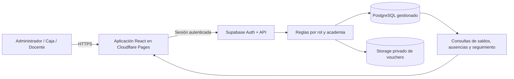

# PLAN FINAL — SaaS de cobranza y asistencia para academias preuniversitarias

> **Archivo canónico de ejecución.** Este plan fija responsables y calendario. El [contrato funcional del MVP](#/documentos/CONTRATO_FUNCIONAL_MVP.md) fija el comportamiento acordado con Daniel y prevalece si un ejemplo de este plan quedara desactualizado. El equipo técnico debe revisar su viabilidad antes de integrar código. Ninguno de los dos documentos afirma que el software o el negocio ya estén validados.

**Actualización del 17 de noviembre:** Daniel cerró `R01` tras analizar las respuestas de Fernando y Yony. Juan no respondió; sus decisiones de interfaz pasan a `F01`-`F03`. Los contratos técnicos y bloqueos de cloud continúan en `B01` y `C01`. Ver [acta de cierre](#/documentos/ACTA_CIERRE_R01.md).

**Periodo:** 16 al 23 de noviembre de 2026, hora de Lima  
**Entrega oficial:** 23 de noviembre, 23:00  
**Meta interna de carga:** 23 de noviembre, antes de las 20:00  
**Equipo:** Juan Alexis Quispe Luque, Fernando Perez del Castillo, Yony Alex Vilca Mamani y Daniel Casas  
**Estado del SaaS al definir el flujo:** el repositorio solo contiene un README; se usarán servicios cloud.
**Documento de referencia:** consigna y rúbrica del curso, conservadas por el equipo en su repositorio de trabajo.

## 0. Cómo debe usar este plan cualquier agente de IA

1. Leer **este plan, el contrato funcional del MVP, la tarea asignada y su criterio de aceptación** antes de proponer código o texto.
2. Trabajar solo en una tarea identificada en el backlog de la sección 7. El agente puede proponer cambios de alcance, pero Daniel decide prioridades; Fernando aprueba cambios de esquema, permisos y reglas de pago.
3. Entregar siempre: **qué cambió, archivos afectados, cómo se probó, resultado observado, riesgos pendientes y siguiente dependencia**. No presentar una sugerencia como funcionalidad terminada.
4. Usar únicamente datos ficticios de estudiantes; no introducir claves, contraseñas ni identificadores reales en prompts, código, capturas o ZIP.
5. Priorizar **evidencia académica**: software que funciona, pruebas y documentación. La validación comercial queda en pausa hasta un nuevo acuerdo del equipo; no se afirmará rentabilidad a partir de datos ficticios.
6. Si se detecta un fallo de seguridad, saldo, aislamiento de academias o persistencia, se marca **bloqueante**. Ninguna mejora estética o P1 se integra hasta corregirlo.

**Formato mínimo de reporte de un agente:** `Tarea ID | responsable humano | estado | cambio | prueba ejecutada y resultado | enlace/ruta del artefacto | bloqueo o decisión necesaria`.

## 1. Decisiones cerradas

1. El producto será un SaaS web para academias preuniversitarias pequeñas, inicialmente una sede por academia.
2. El MVP seguirá el [contrato funcional](#/documentos/CONTRATO_FUNCIONAL_MVP.md): matrícula activa o excepcional, cupos y cambios de turno, inscripción y mensualidades, pagos bancarios manuales con voucher, asistencia por clase, alertas y seguimiento. No procesará dinero ni integrará pasarela.
3. La demostración utilizará **datos ficticios**. Daniel definió el flujo a partir de su experiencia y lo presentó como base funcional; Juan, Fernando y Yony revisarán viabilidad técnica y contratos. La validación comercial queda en pausa.
4. No se estimará el trabajo por horas individuales. Cada día tendrá un resultado verificable, responsables y una decisión de continuar o recortar alcance.
5. Cada integrante participará en el informe y en la exposición; Daniel coordinará la integración documental y el control del proyecto.

## 2. Problema, cliente y promesa de valor

**Organización usuaria:** academia preuniversitaria pequeña.

**Usuarios del sistema:** dirección, secretaría y docentes.

**Problema operativo:** matrícula, cupos, pagos bancarios, vouchers y asistencia se registran en lugares distintos; por ello se identifican tarde deudas y faltas, y es difícil seguir acuerdos con apoderados. El flujo detallado fue descrito por Daniel desde su experiencia en academias; todavía no constituye validación comercial externa.

**Valor que la demo debe probar:** dirección puede autorizar excepciones y cambios de turno sin exceder cupos; secretaría confirma inscripción y pagos con voucher, detecta deuda y registra contacto; docentes toman lista por clase; las alertas de 10 faltas y revisión al límite configurado se calculan desde datos persistentes. La aplicación debe demostrar el recorrido completo, no pantallas simuladas.

## 3. MVP que demuestra valor

### Recorrido obligatorio de punta a punta

1. **Configuración:** dirección crea ciclo, grupos con turno y cupo, cursos, docentes y reglas de asistencia.
2. **Matrícula:** secretaría registra alumno y apoderados, precio fijo del ciclo, inscripción y mensualidades. Sube el voucher bancario de inscripción; la matrícula se activa al confirmar ese pago. Dirección puede autorizar excepción con motivo y fecha, que ocupa cupo y permite asistir aunque se retrase el pago.
3. **Traslado:** dirección cambia a un alumno de turno solo si hay cupo en el grupo destino; se conserva historial.
4. **Cobranza:** secretaría registra pagos totales o parciales por banco, cada uno con voucher, tras verificarlos externamente. El sistema calcula saldos desde pagos confirmados no anulados. Dirección puede anular errores con motivo. No se acepta efectivo.
5. **Asistencia:** el docente crea sesión de grupo, curso, fecha y hora; marca presente, ausente o tardanza. La regla del ciclo indica si la tardanza suma falta.
6. **Detección y acción:** el tablero muestra deuda vencida, alerta desde 10 faltas de demostración y casos que alcanzan el límite del ciclo. Secretaría registra contactos y acuerdos; dirección registra una decisión al llegar al límite. El contacto no borra una deuda ni un conteo de faltas.

### Alcance P0: obligatorio para entrega

- Inicio de sesión y autorización efectiva por rol.
- Separación de datos por academia en todas las consultas y escrituras.
- Ciclos, grupos con cupo, cursos, docentes, alumnos/apoderados, matrículas activas o excepcionales y traslados autorizados.
- Inscripción y mensualidades separadas, precio individual del ciclo, pagos bancarios completos o parciales con voucher privado y anulación auditada.
- Sesiones de clase y asistencia; reglas por ciclo para umbrales y tardanzas.
- Tablero calculado desde la base de datos, contactos de secretaría y decisión de dirección al alcanzar el límite de faltas.
- Despliegue cloud con HTTPS y persistencia tras recargar o entrar desde otro navegador.
- Datos ficticios de demostración, pruebas de permisos y una exportación/respaldado reproducible de esos datos para contingencia.

### Alcance P1: solo si P0 está estable al cierre del día 5

- Exportación CSV de deuda y asistencia para el administrador.
- Filtros adicionales por ciclo o grupo.
- Mejoras visuales y accesibilidad que no alteren el flujo principal.

### Fuera del proyecto de ocho días

Efectivo, pasarela de pago, descuento automático por pago completo, mora automática, cargos de materiales, horario semanal automático, emisión tributaria, mensajes automáticos por WhatsApp o SMS, portal de apoderados, aplicación móvil nativa, importación masiva, predicción de deserción y contabilidad. Ninguna de estas funciones debe desplazar el recorrido P0.

## 4. Roles, datos y reglas

| Rol | Puede hacer | No puede hacer |
|---|---|---|
| Dirección (`admin`) | Configurar ciclos, grupos, cupos, cursos, docentes y reglas; autorizar excepciones y traslados; ver finanzas, vouchers y asistencia; anular pagos y decidir al límite de faltas | Acceder a otra academia |
| Secretaría (`cashier`) | Registrar alumnos, apoderados, precios, cargos y vouchers; confirmar pagos bancarios verificados; consultar saldos y asistencia; registrar seguimiento | Autorizar excepciones o traslados, anular pagos o entrar a otra academia |
| Docente (`teacher`) | Ver sus grupos y cursos, crear sesiones y marcar asistencia | Consultar precios, pagos, vouchers, datos de apoderados o grupos no asignados |

**Entidades mínimas:** academia, usuario/rol, ciclo, grupo, curso, asignación docente, alumno, apoderado, matrícula, cargo, pago, voucher privado, sesión, asistencia, traslado, seguimiento y decisión de dirección. Todos los registros de operación tendrán `academy_id`; las relaciones y permisos se comprobarán también en la base de datos. Se impedirán pagos negativos o superiores al saldo, cupos excedidos y una segunda asistencia del mismo alumno en la misma sesión.

**Contrato mínimo de datos para que los agentes implementen lo mismo:**

| Entidad | Campos esenciales | Regla clave |
|---|---|---|
| `academies` | `id`, `name` | Cada organización tiene un identificador distinto. |
| `memberships` | `academy_id`, `user_id`, `role` | Rol `admin`, `cashier` o `teacher` por academia; las cuentas de demo se crean de forma controlada. No se requiere registro público de usuarios en P0. |
| `cycles`, `groups` | Ciclo con fechas, grado, umbral de aviso, límite de revisión y regla de tardanza; grupo con `cycle_id`, turno y capacidad | Activas y excepcionales cuentan para el cupo; aviso menor que límite. |
| `subjects`, `teacher_assignments` | Curso, grupo y docente asignado | Un docente opera solo los grupos/cursos asignados; la sesión identifica curso y hora. |
| `students`, `guardians`, `enrollments`, `transfers` | Datos ficticios de alumno/apoderado; matrícula con `cycle_id`, grupo, precio y estado; traslado con origen, destino y autor | Una matrícula por alumno y ciclo; excepción exige motivo y fecha de dirección; traslado exige cupo y conserva historial. |
| `charges` | Matrícula, tipo `registration` o `monthly`, monto y vencimiento | Inscripción y mensualidades son cargos separados; el precio del ciclo queda fijado al matricular. |
| `payments` | Cargo, monto, fecha, medio bancario, referencia, voucher privado, confirmación, autor y datos de anulación | Cada pago se aplica a un cargo; no efectivo ni pago sin voucher; solo pagos confirmados no anulados reducen saldo. |
| `class_sessions`, `attendance` | Sesión con grupo, curso, fecha/hora y docente; asistencia con matrícula y `status` | Estados `present`, `absent`, `late`; una asistencia por matrícula y sesión. |
| `followups`, `academic_decisions` | Alumno/ciclo, tipo, fecha, canal, nota, autor; decisión y motivo de dirección | Contacto no borra alertas; al límite no hay desaprobación automática. |

**Cálculos únicos para backend y frontend:** saldo del cargo = `amount − suma(payments confirmados no anulados)`; un cargo está vencido si su fecha límite en Lima ya pasó y el saldo es positivo. Para una matrícula excepcional, la nueva fecha aprobada rige el aviso de inscripción impaga. Las faltas del ciclo son las asistencias `absent` más `late` solo cuando la regla del ciclo lo indica. En la demo, el aviso comienza a las 10 y el límite de revisión a las 15; dirección puede configurar ambos umbrales y la regla de tardanza. El caso de deuda deja de estar activo cuando se paga; el de faltas persiste hasta el fin del ciclo bajo el límite, o hasta que dirección registre decisión al alcanzarlo. Contactos y decisiones no se borran. No se utilizarán tareas programadas para crear casos en P0.

**Autorización:** la interfaz puede ocultar acciones, pero la base de datos debe impedirlas también. Una fila de academia A nunca será visible o modificable por usuarios de B. Un docente solo accederá a grupos/cursos asignados y no tendrá permiso de lectura de cargos, pagos, vouchers, datos de apoderados o seguimiento financiero. Las imágenes de vouchers se guardarán en almacenamiento privado con políticas por academia y rol. Los identificadores enviados por el navegador no se considerarán prueba de autorización.

Para un piloto académico se recogerá la información mínima y se usarán datos ficticios. En un uso real con menores, la academia deberá informar adecuadamente sobre el tratamiento de datos y aplicar las reglas de consentimiento correspondientes, además de controles de acceso y retención. Véanse las [orientaciones de la Autoridad Nacional de Protección de Datos Personales](https://www.gob.pe/institucion/minjus/noticias/961170-instituciones-educativas-tienen-la-obligacion-de-informar-adecuadamente-sobre-el-tratamiento-de-datos-personales-de-los-estudiantes) y el [reglamento vigente](https://www.gob.pe/institucion/anpd/campa%C3%B1as/128319-nuevo-reglamento-de-proteccion-de-datos-personales).

## 5. Arquitectura elegida

**Pila propuesta:** React + TypeScript para la aplicación web; Cloudflare Pages para publicar el frontend; Supabase Auth, PostgreSQL, API y Storage privado para autenticación, datos, vouchers y lógica transaccional. Se pueden usar funciones SQL o una función de servidor pequeña para registrar pagos, anulaciones y traslados con control de cupos de forma atómica. Esta elección evita administrar servidores durante los ocho días y deja visibles los conceptos cloud que exige el curso: servicio gestionado, despliegue público, roles, escalabilidad, seguridad y costos. El **tipo de despliegue es público con acceso privado por academia**; el producto vendido al cliente sigue el modelo SaaS, construido sobre servicios PaaS/BaaS gestionados. El informe explicará región elegida, límites del plan, recuperación y ruta de escalado sin atribuir al plan gratuito una disponibilidad garantizada.

Las claves privilegiadas nunca irán en el navegador ni en el ZIP. Las tablas expuestas tendrán políticas de seguridad por fila; se probará la separación con cuentas de dos academias y el bloqueo de finanzas para docentes. [Supabase documenta este control de acceso](https://supabase.com/docs/guides/database/postgres/row-level-security). Se mantendrán migraciones SQL en el repositorio y un archivo `.env.example` sin secretos.

**Límite operativo:** el plan gratuito de Supabase no incluye respaldos automáticos y puede pausar proyectos por inactividad. Sirve para la demostración; una operación comercial requerirá presupuestar plan y respaldo adecuados. [Precios y límites de Supabase](https://supabase.com/pricing).

## 6. Equipo, propiedad del trabajo y agentes de IA

| Integrante | Rol humano y propiedad | Agente de IA asignado y producto esperado | Verificación humana |
|---|---|---|---|
| **Juan Alexis Quispe Luque** | Líder de frontend y experiencia de uso. Responsable de navegación, formularios, tablero e integración visual. | **Agente UI:** propone componentes, validaciones de formulario, estados de carga/error y mejoras de accesibilidad a partir del contrato de datos. | Juan comprueba en navegador cada flujo, incluidos errores y uso móvil. |
| **Fernando Perez del Castillo** | Líder de backend, base de datos y seguridad. Responsable del modelo, reglas de negocio, permisos y cálculos. | **Agente de datos y seguridad:** propone migraciones, consultas, políticas de acceso y pruebas de autorización. | Fernando revisa SQL/código y ejecuta las pruebas de rol y academia. |
| **Yony Alex Vilca Mamani** | Integrador full stack y responsable de cloud. Conecta pantallas y API, configura entornos y despliegues, apoya asistencia y seguimiento. | **Agente de integración:** prepara conectores, scripts de despliegue, datos ficticios y diagnóstico de fallos. | Yony verifica la versión publicada y que los datos persistan. |
| **Daniel Casas** | Gerente de proyecto, documentación y QA; apoyo backend en corrección de defectos. Responsable de alcance, evidencias, informe, paquete y ensayo. | **Agente analista y QA:** convierte la consigna en matriz de requisitos, redacta borradores, genera casos de prueba y comprueba consistencia entre informe y aplicación. | Daniel contrasta fuentes, reproduce pruebas y aprueba el contenido final. |

**Regla de trabajo con IA:** cada tarea entregada a un agente debe indicar entrada, archivo o módulo permitido, criterio de aceptación y prueba esperada. El responsable humano revisa el cambio antes de integrarlo. Los agentes no recibirán datos personales reales, claves de servicio ni capacidad de publicar por su cuenta. Un resultado generado por IA no se declarará probado hasta que una persona lo ejecute.

**Coordinación técnica:** Fernando fija el esquema y las reglas; Juan consume el contrato acordado; Yony resuelve integración y despliegue; Daniel valida el recorrido completo. La rama principal siempre debe permanecer ejecutable. Cada día se hace una reunión breve de bloqueos y una demo de la versión integrada; no se acepta trabajo que solo funcione en el equipo de su autor.

**Ubicación prevista de artefactos en el repositorio del SaaS:** `src/` (interfaz, Juan), `supabase/migrations/` (esquema y políticas, Fernando), `supabase/seed/` (datos ficticios, Yony), `tests/` (pruebas, Daniel y dueños técnicos), `docs/` (diagramas, evidencias, informe y diapositivas, Daniel), `README.md` y `.env.example` (Yony). En el repositorio de este panel, `docs/PLAN_FINAL.md` y `docs/CONTRATO_FUNCIONAL_MVP.md` son las versiones compartidas para coordinación. Los cambios posteriores se harán por PR. Si el equipo elige otra estructura para el SaaS, Yony la documentará en su README antes de repartir tareas. Los agentes no editarán el mismo archivo simultáneamente; cada cambio se revisará e integrará en partes pequeñas.

## 7. Backlog y cronograma de ocho días

### 7.1. Tareas con dueño y aceptación

Los agentes reciben una **ID** y el criterio de aceptación de esta tabla. P0 tiene precedencia sobre cualquier tarea P1. Los dueños pueden pedir ayuda a otro integrante, pero no ceden la aprobación final.

| ID / prioridad | Dueño | Entregable verificable | Depende de | Aceptación mínima |
|---|---|---|---|---|
| `R01` / P0 | Daniel | Contrato funcional basado en su experiencia, recorrido y matriz requisito–evidencia | Ninguna | Daniel presenta `CONTRATO_FUNCIONAL_MVP.md`; el equipo registra viabilidad técnica y contratos de implementación el día 1. |
| `C01` / P0 | Yony | Repositorio, configuración, despliegue React y `.env.example` | `R01` | URL HTTPS abre la aplicación; ningún secreto queda en código o ZIP. |
| `B01` / P0 | Fernando | Migraciones, Auth, roles, políticas por academia y Storage privado | `R01` | Tres roles entran; docente no lee finanzas, apoderados ni vouchers y academia B no lee datos de A por API/Storage. |
| `B02` / P0 | Fernando | Ciclos, grupos/cupos, cursos/docentes, alumnos/apoderados, solicitudes y cargos | `B01` | Inscripción y mensualidades con precio por ciclo persisten; solicitud sin pago ni excepción sigue pendiente. |
| `F01` / P0 | Juan | Navegación y formularios de ciclo, grupo, matrícula y cargos | `C01`, contrato de `B02` | Datos reales con validación, estados de carga y error; dirección y secretaría ven solo sus acciones. |
| `B03` / P0 | Fernando | Pagos bancarios con voucher, activación, parciales, anulación y saldo transaccional | `B01`, `B02` | Inscripción confirmada activa matrícula; cada pago exige voucher; S/80 sobre S/200 deja S/120; se rechazan efectivo y sobrepago. |
| `B04` / P0 | Yony | Sesiones por grupo/curso y asistencia por docente | `B01`, `B02` | Solo docente asignado toma lista; tardanza se cuenta según ciclo y se impide duplicar asistencia. |
| `B06` / P0 | Yony con revisión de Fernando | Matrícula excepcional y traslado con autorización/cupo | `B02` | Dirección registra motivo/fecha; excepcional ocupa cupo y sigue asistiendo tras vencimiento; traslado a grupo lleno se rechaza conservando historial. |
| `F02` / P0 | Juan | Pantallas de pago con voucher y toma de asistencia | `B03`, `B04` | Pago y pase de lista funcionan en cloud; docente no ve datos financieros. |
| `B05` / P0 | Fernando | Consultas de deuda/faltas y decisión de dirección | `B03`, `B04`, `B06` | Aviso a 10, revisión a 15 en datos de demo; ambos configurables, sin desaprobación automática; deuda calculada en BD. |
| `F03` / P0 | Juan + Yony | Tablero, seguimiento, excepciones, traslados y decisión | `B05`, `B06` | Contactos quedan registrados; alertas cambian por pago/asistencia y decisión, no por datos fijos. |
| `Q01` / P0 | Daniel | Matriz de pruebas y evidencias de ejecución | `B01`–`F03` | Pasan todas las pruebas de salida de la sección 8; defectos bloqueantes resueltos. |
| `D01` / P0 | Daniel | Informe PDF, diapositivas, guion y ZIP reproducible | Evidencia técnica diaria y `Q01` | Cumple la matriz académica de la sección 11 y abre correctamente. |
| `F04` / P1 | Juan | CSV de deuda/asistencia y filtros adicionales | P0 estable al cierre del día 5 | Exportación corresponde a datos visibles y respeta rol/academia. |

### 7.2. Calendario y puertas de salida

| Fecha | Juan — frontend | Fernando — backend/datos | Yony — integración/cloud | Daniel — dirección/QA/informe | Puerta de salida verificable |
|---|---|---|---|---|---|
| **Lun. 16** | Revisa contrato y dibuja pantallas de dirección, secretaría y docente. | Revisa contrato; define esquema, políticas y transacciones de pago/cupo. | Revisa contrato; prepara app, cloud y estructura de despliegue. | Presenta el contrato y matriz requisito–evidencia; registra observaciones técnicas. | Los cuatro conocen el flujo; contratos y riesgos técnicos quedan registrados. |
| **Mar. 17** | Navegación, inicio de sesión y formularios base. | Auth, roles, aislamiento y políticas de Storage privado. | Despliegue accesible, variables seguras e integración de sesión. | Redacta problema, objetivos y método; prepara pruebas por rol y voucher. | Tres roles entran en cloud; docente no puede abrir finanzas ni vouchers. |
| **Mié. 18** | Pantallas de ciclo, grupo/cupo, alumno/apoderado y cargos. | Persistencia de configuración, solicitud de matrícula, inscripción y mensualidades. | Conecta frontend/API; verifica recarga y segundo navegador. | Prueba cupos, precio individual y persistencia; documenta modelo. | Solicitud de alumno y cargos persisten; aún no se activa sin pago o excepción. |
| **Jue. 19** | Pantallas de pago con voucher y asistencia. | Pago bancario total/parcial, voucher privado, activación, saldo y anulación. | Sesiones/asistencia y traslado/excepción con autorización; integra flujos. | Prueba voucher, sobrepago, cupo, duplicados y permisos; redacta arquitectura. | Inscripción pagada activa; pago parcial cambia saldo; docente guarda lista; traslado a grupo lleno falla. |
| **Vie. 20** | Tablero de deuda/faltas, contactos y decisión de dirección. | Consultas de vencidos, 10/15 faltas configurables y resolución. | Integra recorrido completo y publica versión candidata. | Ejecuta demo de punta a punta, registra defectos y métricas observadas. | **MVP P0 completo en cloud** antes del cierre del día. |
| **Sáb. 21** | Corrige fallos de uso y formularios; P1 solo si P0 ya pasó. | Corrige seguridad, voucher, saldos y consistencia. | Prepara datos ficticios para umbrales, migraciones y recuperación. | Prueba dos academias, tres roles, recarga, cupos, pagos y asistencia; incorpora evidencia real. | P0 pasa las pruebas; lista de defectos críticos vacía. |
| **Dom. 22** | Ajustes finales de legibilidad y recorrido de demo. | Revisión final de políticas y reglas. | Congela despliegue estable, prepara ZIP reproducible y respaldo de datos ficticios. | **Congela nuevas funciones al mediodía**; cierra informe, referencias, presentación y primer ensayo de 50 minutos. | PDF, ZIP y demo ensayados; solo quedan fallos bloqueantes. |
| **Lun. 23** | Resuelve únicamente fallos que impiden la demo. | Revisa que no haya acceso indebido ni errores de saldo. | Verifica URL, credenciales de demo y paquete; conserva última versión estable. | Ensayo final, revisión de formato y carga de los dos archivos antes de las **20:00**; registra confirmación de entrega. | Entrega confirmada y demo lista, con margen hasta las 23:00. |

**Ruta crítica:** contrato/modelo/autorización → matrícula, cupos y cargos → voucher/pago, excepción/traslado y asistencia → alertas/seguimiento/decisión → integración desplegada → pruebas → demo e informe final. Las tareas documentales empiezan el día 1; no se posponen al final. La validación comercial no forma parte de esta ruta.

## 8. Criterios de aceptación y demostración

Preparar dos academias ficticias, un ciclo de tres meses por academia, grupos con cupos y alumnos inventados. Un caso principal tendrá inscripción confirmada y tres mensualidades; una mensualidad de S/200 vencida bajará a S/120 tras un pago bancario parcial de S/80 con voucher. Otro alumno tendrá nueve faltas históricas ficticias: la décima ausencia registrada en una sesión real activará el aviso. Otro caso con 14 faltas permitirá demostrar que la decimoquinta alerta a dirección sin desaprobación automática. El seed debe crear registros en la base de datos, no indicadores codificados en la UI.

La demo de 10–15 minutos seguirá este guion:

1. Dirección configura ciclo, grupo con cupo, curso, docente y reglas de asistencia; autoriza una excepción y muestra que ocupa cupo.
2. Secretaría registra otro alumno, precio, inscripción y mensualidades; sube voucher bancario y confirma inscripción. Registra pago parcial de mensualidad con otro voucher; muestra saldo e historial.
3. Dirección traslada un alumno a turno con cupo; intenta traslado a grupo lleno y muestra el rechazo sin perder historial.
4. Docente crea una sesión de grupo/curso y marca la décima falta de un alumno; el tablero muestra el aviso. Demuestra que no ve finanzas ni vouchers.
5. Secretaría registra contacto con apoderado. Dirección recibe la alerta al llegar al límite y registra su decisión; el sistema no desaprueba por sí solo.
6. Recargar o abrir otro navegador: los cambios persisten. Entrar a la segunda academia: no aparecen datos ni vouchers de la primera.

**Pruebas de salida P0:** Daniel registrará resultado, fecha, navegador/cuenta de prueba y evidencia de cada caso. Fernando revisará los casos de datos y seguridad; Yony los de despliegue.

| Caso | Acción | Resultado esperado |
|---|---|---|
| `A01` | Crear ciclo, grupo con cupo, curso y docente; matricular alumno con inscripción y tres mensualidades | Precio individual, grupo, cargos y reglas persisten tras cerrar sesión y volver. |
| `A02` | Confirmar inscripción con voucher; intentar activar otra sin pago ni autorización | Primera matrícula activa; segunda no activa ni ocupa cupo. |
| `A03` | Dirección autoriza excepción con motivo/fecha; vence sin pago | Ocupa cupo, alumno sigue en lista y secretaría ve inscripción pendiente para contacto. |
| `A04` | Trasladar alumno a grupo con cupo y luego intentar a grupo lleno | Primer traslado funciona; segundo se rechaza y ambos conservan historial/cupos correctos. |
| `A05` | Aplicar S/80 con voucher bancario a mensualidad de S/200 | Saldo S/120 en ficha y tablero; voucher privado e historial conservados. |
| `A06` | Intentar efectivo, pago sin voucher, S/121 adicionales sobre saldo S/120 y monto negativo | Todos se rechazan sin alterar saldos. |
| `A07` | Anular pago como dirección con motivo; intentar como secretaría | Saldo se restablece y queda rastro; secretaría no puede anular. |
| `A08` | Docente crea sesión por grupo/curso y registra décima falta; alterna regla de tardanza | Aviso desde 10 faltas efectivas del ciclo; tardanza suma solo según configuración. |
| `A09` | Alcanzar límite de 15 faltas de demo | Dirección recibe alerta; no hay desaprobación automática; su decisión y motivo quedan registrados. |
| `A10` | Intentar duplicar asistencia o abrir sesión de grupo no asignado | No se duplica la fila ni se concede acceso al otro grupo. |
| `A11` | Consultar por API pagos, vouchers y apoderados como docente | Acceso denegado; ocultar botones por sí solo no cuenta como prueba. |
| `A12` | Consultar datos y Storage de academia A con usuario de B, incluso cambiando IDs | No se leen ni modifican registros ni imágenes de A. |
| `A13` | Registrar contacto en deuda/faltas; pagar saldo y cerrar ciclo bajo límite | Deuda sale de activos al pagar; faltas conservan contacto y se cierran al fin del ciclo. |
| `A14` | Abrir URL pública desde otro navegador y repetir el recorrido principal | Datos persisten, roles se respetan y la aplicación funciona por HTTPS sin equipo local. |

Una funcionalidad se considera terminada si cumple simultáneamente: está integrada en la versión cloud, usa datos persistentes, respeta permisos, pasa su prueba de aceptación y está reflejada con precisión en el informe.

## 9. Informe, exposición y entrega

El informe seguirá la estructura requerida por la consigna: portada e índice numerado; introducción; problema; objetivos; marco teórico de IaaS, PaaS y SaaS, regiones, zonas, disponibilidad y escalabilidad; propuesta funcional y técnica; roles; módulos; arquitectura; despliegue; seguridad y respaldo; plan de implementación con recursos de hardware, software y cloud; evaluación descriptiva mediante pruebas, métricas y costos estimados; conclusiones, referencias y anexos. Para conciliar la página que pide **capítulos I, II y III** con la estructura formal posterior de diez apartados, se agruparán así: **I. problema, objetivos y marco teórico; II. propuesta técnica; III. implementación, evaluación y conclusiones**. La portada tendrá universidad, carrera, escudo, curso, título, docente, cuatro integrantes y ciudad/país/año. Daniel mantendrá una **matriz de trazabilidad** entre cada sección, funcionalidad y evidencia del sistema. El formato del PDF será Times New Roman 12, interlineado 1,5, texto justificado, títulos de 14 en negrita y subrayado, encabezado, pie y numeración; referencias en estilo APA según la rúbrica. El informe incluirá diagrama de arquitectura, proceso, modelo de datos, organización de módulos, capturas reales, cronograma y requisitos.

**Reparto de los 50 minutos de exposición, con participación de todos:**

| Tramo | Responsable principal | Evidencia |
|---|---|---|
| 0–10 min: problema, cliente, objetivos y alcance | Daniel | Flujo anterior y valor esperado |
| 10–22 min: experiencia de uso y módulos | Juan | Pantallas y recorrido de usuario |
| 22–34 min: arquitectura, datos, cloud y seguridad | Fernando | Diagrama, roles y aislamiento |
| 34–46 min: demo en vivo y despliegue | Yony, con intervenciones de Juan y Fernando | Recorrido real publicado |
| 46–50 min: pruebas, límites y siguientes pasos | Daniel | Matriz de resultados y costos |

Se prepararán respuestas para hasta cinco minutos adicionales de preguntas. Las capturas del informe se tomarán de la aplicación real. Los costos cloud se citarán desde tarifas oficiales y se distinguirán de hipótesis comerciales.

**Paquete:** (1) informe final en PDF; (2) ZIP con código fuente, migraciones, instrucciones de instalación, `.env.example`, datos ficticios, diapositivas y guía de demostración. El ZIP no contendrá claves, contraseñas privadas ni datos de alumnos reales. Como la carga en Classroom admite un solo intento, Daniel y Yony verificarán nombres, apertura de archivos y contenido antes de que el responsable los suba.

## 10. Riesgos, disparadores y respuesta

| Riesgo | Señal temprana | Respuesta acordada |
|---|---|---|
| El modelo o los permisos retrasan todos los módulos | No hay inicio de sesión y tablas operativas al cerrar el día 2 | Fernando y Yony concentran trabajo en Auth y esquema; Juan usa el contrato ya definido para avanzar pantallas. |
| La integración se retrasa | El día 4 no funciona matrícula → cuota → pago en cloud | Se eliminan P1 y detalles visuales; se corrige el recorrido P0 antes de añadir más funciones. |
| El tablero muestra cifras inconsistentes | Saldo o alerta difiere del registro de prueba | Se bloquea la demo de esa versión y se corrige la consulta; nunca se sustituyen cálculos por números fijos. |
| Un rol ve datos indebidos | Docente abre finanzas/voucher o una academia consulta otra | Defecto bloqueante: Fernando corrige políticas de base de datos y Storage antes de continuar. |
| Se pierde un voucher o falla el cupo | Un pago no conserva imagen o un traslado supera capacidad | Se bloquea el flujo afectado; Fernando revisa transacción/política y Yony verifica almacenamiento e integración. |
| El servicio gratuito falla cerca de la exposición | URL o base no responde en ensayo | Yony restaura la última versión estable y conserva capturas/video **solo como apoyo**, identificándolos como respaldo; se intenta mantener el recorrido en vivo. |
| El informe se deja para el final | Se llega al día 5 sin secciones técnicas | Daniel solicita a cada responsable diagrama, decisiones y pruebas del módulo al cerrarlo; se prioriza completar informe en paralelo. |

## 11. Verificación frente a la consigna académica

**Estado de esta matriz:** el plan cubre las actividades necesarias; el cumplimiento final se confirmará únicamente cuando existan y se revisen los artefactos indicados. No se debe presentar este plan como si fuera el informe o la aplicación terminada.

**Validación con clientela real:** el PDF no fija un porcentaje ni exige entrevistas, pilotos o clientes reales para aprobar. Sí pide justificar el problema y describir la evaluación de resultados, incluidas métricas de satisfacción del usuario. Si no se mide satisfacción con usuarios externos, se informará expresamente esa limitación y no se presentarán opiniones del equipo como validación comercial.

| Requisito del PDF | Evidencia de entrega | Responsable y momento de verificación |
|---|---|---|
| SaaS web que resuelve una necesidad específica y aplicación demostrable | URL pública, recorrido P0 con datos persistentes y capturas coherentes | Yony y Daniel, días 5–7 |
| Usuarios, roles, funciones y paneles pertinentes | Matriz de permisos, pantallas por rol y pruebas de bloqueo | Fernando, Juan y Daniel, días 5–6 |
| Arquitectura cloud, componentes, modelo de despliegue y escalabilidad | Diagrama frontend/API/Auth/BD, servicios elegidos, región, límites y ruta de escalado | Fernando y Yony, días 4–7 |
| Seguridad, respaldo y recuperación | Políticas por academia, pruebas de acceso, procedimiento de exportación/restauración y limitaciones del plan gratuito | Fernando y Yony, días 6–7 |
| Problema, objetivos, marco teórico y justificación | Capítulo I con fuentes, flujo descrito por Daniel y límites de esa evidencia; sin atribuirle validación externa | Daniel, día 7 |
| Plan de implementación, cronograma y recursos | Capítulo III con este calendario, dependencias, herramientas y decisiones de alcance | Daniel, día 7 |
| Evaluación descriptiva: funcionalidad, rendimiento, escalabilidad, satisfacción y costos | Tabla de pruebas ejecutadas, tiempos observados, límites de capacidad y prueba sencilla de carga, opinión de usuarios externos si se obtuvo y estimación cloud trazable; sin inventar satisfacción | Daniel con Yony, día 7 |
| Estructura y formato del informe, anexos y referencias APA | PDF con portada completa, índice numerado, tres capítulos, referencias, anexos, tipografía y numeración exigidas | Daniel y revisión cruzada de Juan, día 8 |
| Exposición grupal de 50 minutos con aplicación y apoyo visual | Diapositivas, diagramas, demo cronometrada y participación de los cuatro | Todo el equipo, ensayos días 7–8 |
| Entrega por Classroom de informe y proyecto comprimido en un intento | PDF y ZIP abiertos y revisados; captura de confirmación de carga | Daniel y Yony, día 8 antes de las 20:00 |

**Observación de plazo:** la consigna enumera 4 días de análisis, 12 de desarrollo y 2 de reporte, pero la fecha de entrega confirmada deja ocho días de trabajo. Este plan comprime las fases y prepara el informe en paralelo; se explicará esa decisión en el cronograma del proyecto.

## 12. Validación comercial en pausa

El equipo acordó no realizar entrevistas, comparar precios, estimar mercado ni afirmar rentabilidad durante el sprint académico. Daniel reabrirá estas actividades solo después de que el equipo acuerde un objetivo y un método. La descripción del flujo aportada por Daniel se usa para definir el MVP, no como prueba de demanda o disposición a pagar.

La entrega del 23 de noviembre se evalúa con la aplicación cloud funcional, pruebas, informe y exposición. Las métricas de satisfacción que pide la consigna se reportarán únicamente si se obtienen de una prueba real; de lo contrario, el informe declarará esa limitación sin fabricar resultados.
## 13. Fuentes base para el informe

- Consigna y rúbrica del curso: PDF proporcionado por el docente y conservado por el equipo.
- [Supabase: seguridad por fila](https://supabase.com/docs/guides/database/postgres/row-level-security).
- [Supabase: precios y límites](https://supabase.com/pricing).
- [Cloudflare: despliegue de React en Pages](https://developers.cloudflare.com/pages/framework-guides/deploy-a-react-site/).
- [Autoridad Nacional de Protección de Datos Personales: reglamento vigente](https://www.gob.pe/institucion/anpd/campa%C3%B1as/128319-nuevo-reglamento-de-proteccion-de-datos-personales).

Las referencias finales del informe se completarán en APA con fecha de consulta y solo con fuentes realmente utilizadas.
